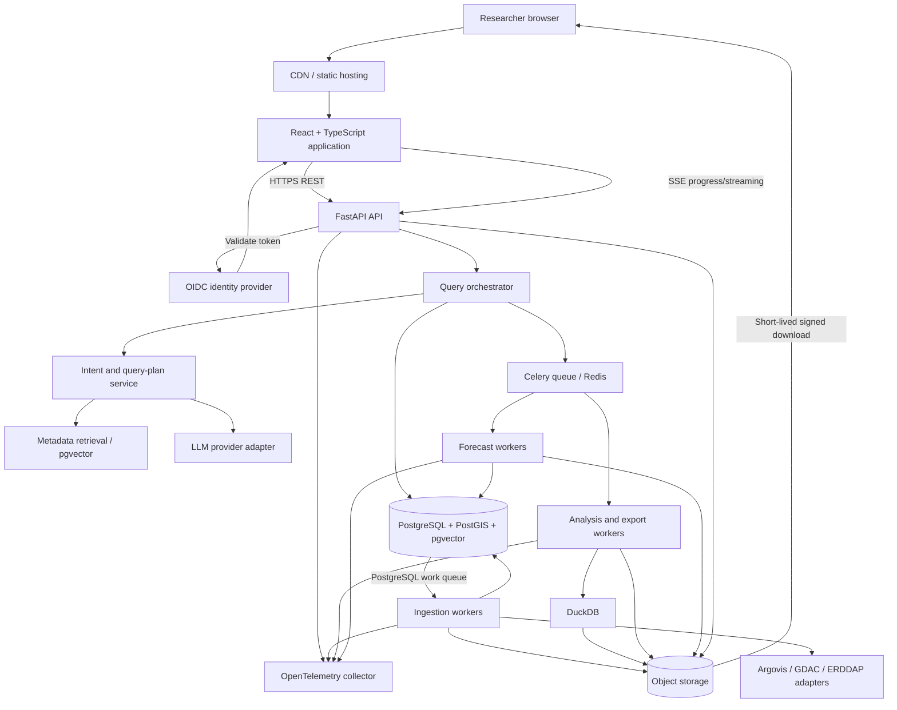

# FloatChat

FloatChat is a research workspace for exploring Argo ocean observations through a conversational interface. This repository is being rebuilt from a hackathon prototype into a Python/React monorepo. Stage 0 provides local infrastructure and a tested scaffold; scientific ingestion, query features, and LLM integration belong to later stages.

**Status: under construction. Stages 1 (Argovis ingestion), 2 (query engine and API) and 3 (web dashboard) are accepted and merged; Stage 4 (natural-language assistant, retrieval and the golden benchmark) is in review on `codex/stage-4`.**

## Local development

Required cloud infrastructure cost: **zero**. PostgreSQL/PostGIS/pgvector, Redis, MinIO, FastAPI, and React/Vite run locally in Docker. Stage 1 ingestion workers claim work from a PostgreSQL queue instead of Celery (stage1-v4, ADR-0047); Redis remains for the API. Startup and tests require no LLM calls, Argovis access, production credentials, or cloud services.

The supported development environment is WSL2 Ubuntu 24.04 with Docker Desktop's Linux engine and WSL integration. Docker/WSL installation is a prerequisite. Use a separate checkout on the WSL Linux filesystem; do not move or rewrite the preserved dirty Windows checkout. Windows Docker acceptance and the complete Ubuntu Make verification passed. The fresh merged-main clone also passed the full CI-equivalent suite; see the gate report.

Prerequisites: Git, GNU Make, Python 3.12.12, uv 0.10.4, Node 24.15.0, pnpm 10.33.0, OpenSSL 3.x CLI for ephemeral localhost TLS regression certificates, and Docker Desktop with Compose v2 supporting `--wait` and successful initialization dependencies. Container bases are pinned by digest in `infra/images.json`; upstream source archives are checksum-pinned. The MinIO server/client build from source and require no account or license purchase. First builds download public dependencies and can take up to 20 minutes; service startup is measured separately.

Create a fresh clone on the Linux filesystem, then run from its root:

```bash
git clone https://github.com/Proxpekt/FloatChat.git ~/FloatChat
cd ~/FloatChat
```

Open Ubuntu with `wsl -d Ubuntu-24.04`, install the pinned prerequisite tools, and use a fresh Linux-filesystem clone. For the corrections awaiting review, check out `codex/stage-0-review-fixes`. From the repository root:

```bash
python3 scripts/security/install_gitleaks.py
make setup
pnpm --filter @floatchat/web exec playwright install --with-deps chromium
make dev
```

Open http://127.0.0.1:5173. API health endpoints are http://127.0.0.1:8000/v1/health/live and http://127.0.0.1:8000/v1/health/ready.

### Stage 2 query API

The API documents itself at http://127.0.0.1:8000/docs (OpenAPI at `/openapi.json`, committed as
`apps/api/openapi.json`; the TypeScript client in `apps/web/src/api/` is generated from it with
`pnpm --filter @floatchat/web generate:api`). Endpoints: `GET /v1/catalog/parameters`,
`GET /v1/catalog/coverage`, `GET /v1/floats`, `GET /v1/floats/{platform_number}`,
`GET /v1/profiles`, `GET /v1/profiles/{profile_id}` and `POST /v1/query`, which takes one
validated `stage2-plan-v1` document and compiles it to parameterised PostgreSQL or bounded DuckDB
(no raw SQL anywhere; see [docs/stage2-plan.md](docs/stage2-plan.md) and
[docs/stage2-query-engine.md](docs/stage2-query-engine.md)). The API reads through the
`floatchat_query` login (SELECT on the `app.query_*` views only, statement timeout).

A fresh dev stack holds no science. The accepted Jan-Mar 2025 data of the preserved acceptance
session is copied in with (ADR-0059; the session is started read-only and stopped again):

```bash
uv run --all-packages --frozen python scripts/stage2_dataset.py import --session 302412131a7c99fb
```

Named regions (Arabian Sea, Bay of Bengal, Laccadive Sea, Andaman Sea, Indian Ocean (IHO)) come
from Flanders Marine Institute (2018), IHO Sea Areas, version 3, https://www.marineregions.org/,
https://doi.org/10.14284/323 (CC-BY 4.0), simplified and recorded per ADR-0060.

The original Windows checkout is preserved with its old Git objects. Its push URL is disabled to prevent contaminated-history publication. Use a fresh Linux clone for development; do not merge its ancestry or push it.

`make dev` creates missing development configuration in an access-restricted directory **outside the checkout**, runs ordered migrations and private bucket/application-policy initialization, and waits for health. Linux defaults to `~/.local/state/FloatChat/development`; Windows tooling defaults to `%LOCALAPPDATA%/FloatChat/development`. Set `FLOATCHAT_CONFIG_DIR` to another protected, non-synced directory. Existing configuration is never overwritten. `.env.example` documents every application variable. Edit the generated `.env` to configure `DATABASE_URL`, `REDIS_URL`, and object-storage settings; defaults point to local containers. Do not place administrative credentials in the API, worker, or browser configuration.

```bash
make test
make lint
make typecheck
make integration
make secrets-current
make secrets-history
make stop
```

`make stop` preserves volumes. `make restart` restarts application services. There is no ordinary reset/volume-deletion command. Integration uses a unique project and unused loopback ports, stops that project afterward, and retains its volumes. It never interrupts the normal development project. Restricted configuration and diagnostic logs are retained outside Git alongside those volumes. The reports identify retained test projects for later owner-controlled cleanup.

Empty-volume startup must finish within 300 seconds after builds; subsequent startup must finish within 120 seconds. Readiness returns a sanitized `503` within five seconds when a required dependency is unavailable. Liveness remains `200` while the API process runs. Database and Redis have no published ports; API and web bind to loopback only. The application bucket is private.

### Stage 3 web dashboard

The React dashboard (Vite, React Router, TanStack Query, MapLibre GL, Plotly) runs at
http://127.0.0.1:5173 against the local API: `/dashboard` (coverage panel, profile map, time
series and distribution charts), `/explore/map` (clustered profile locations, float trajectories,
the region bounding box, a profile list as the keyboard path) and `/explore/profiles` (profile
list, temperature and salinity against pressure, temperature-salinity diagrams). Every filter
lives in the URL, for example:

```text
http://127.0.0.1:5173/dashboard?region=Arabian%20Sea&start=2025-01-01&end=2025-02-01&depth_min=0&depth_max=100&qc=science_ready
```

Every result shows its PRD §17 provenance; every chart has a table view and units on its axes;
the basemap is a bundled Natural Earth land layer (no tile server, nothing fetched from the
network; see ADR-0062). The other PRD §14.1 routes are stubs naming the stage that delivers
them. Design and decisions: [docs/stage3-plan.md](docs/stage3-plan.md), ADR-0061 to ADR-0065.

Screenshots of the acceptance run on the imported Jan-Mar 2025 dataset are under
`reports/stage3-acceptance-<date>/` with the report `reports/stage3-acceptance-<date>.json`
(`scripts/stage3_acceptance.py`). The end-to-end scenario (`apps/web/e2e/dashboard.spec.ts`)
runs in CI against the Docker stack seeded by `scripts/science_seed.py` (ADR-0063).

### Stage 4 natural-language assistant

The `/chat` route turns a question into a validated `stage2-plan-v1` document, runs it through
the same query engine as the dashboard and shows "How FloatChat interpreted your request"
(period, area, depth, variables, QC policy, operation, presentation, retrieved documents, the
model and prompt version, the plan and its hash). Numbers in an answer come from the executed
query; a model narrative is kept only when every number it states is in the result summary.

- Provider: `LLM_PROVIDER=gemini` by default with `GEMINI_API_KEY`; without a key the chat
  answers `llm_unavailable` and the dashboard, map, profiles and `POST /v1/query` are unaffected.
  `LLM_PROVIDER=offline` opts into a deterministic rule-based planner (`offline-rules-v1`) that
  the tests, CI and the harness use; it names itself in the interpretation panel.
- The key belongs in `~/.local/state/FloatChat/development/.env` (the stack's config file),
  not in the repository `.env`; recreate the stack with `make dev` after adding it.
  `LLM_FALLBACK_MODELS` (default `gemini-3.7-flash,gemini-3-flash-preview`) answers when the primary model fails or is
  overloaded.
- Corpus: `python3 -m scripts.dev seed-corpus` embeds parameter, QC, region (with aliases),
  help and example documents into `app.semantic_document` (pgvector, 768 dimensions); `make dev`
  does it at the end of start-up.
- Costs: every model call is a row in `app.llm_call`; `LLM_DAILY_USD_CAP` and
  `LLM_DAILY_TOKEN_CAP` stop the assistant for the UTC day; prices are configuration
  (`packages/core/src/floatchat_core/llm/pricing.py`, versioned, with the source URL).
- Benchmark: `eval/golden` (61 development and 121 held-out items, drafted by the builder and
  awaiting human review); `make eval-nl` writes `reports/eval_nl_<date>.md`.

#### Results

| Report | Provider | Split | Plan exact match (schema-only / with retrieval) | Result accuracy |
|---|---|---|---|---|
| [eval_nl_2026-10-12](reports/eval_nl_2026-10-12.md) | `offline-rules-v1` (**not an LLM**; no key existed on the host) | held-out, 121 items | 72.0% / 83.0% | 89.2% (93 executed) |

The Stage 4 research number (RQ1, PRD §30.1) is the held-out plan accuracy of a model run; it is
reported here only when a committed report from `make eval-nl` with a model key exists.

### Stage 5 historical jobs and exports

Requests longer than the dashboard's 366 days run as durable background jobs (PRD §2.3, §9.3):
`POST /v1/exports` answers `202` with a job; `GET /v1/jobs`, `GET /v1/jobs/{id}`,
`GET /v1/jobs/{id}/events` (SSE with `id:` lines and `Last-Event-ID` resume) and
`POST /v1/jobs/{id}/cancel` follow it; `GET /v1/artefacts/{id}/download?token=` streams the
file through a fifteen-minute signed link. The `/jobs` route lists this browser's jobs; the
dashboard's "Export filtered dataset" creates one for the current filters, and the chat offers
one when a question spans more than a year. Design: [docs/stage5-plan.md](docs/stage5-plan.md),
ADR-0077 to ADR-0081.

- A job plans its months × tiles against the coverage catalogue: months already committed are
  reused; missing months become `historical` ingestion runs (one per calendar year, reference
  time = requested end, tiles of the region only) through the Stage 1 pipeline; the export is
  one DuckDB `COPY` over the verified Parquet parts in the jobs worker, one row per measurement
  level with the policy-selected value and its QC, adjusted and data-mode columns, plus
  `manifest.json` (`export-manifest-v1`: counts, SHA-256, coverage and gaps, partitions, the
  Argo and Argovis citations) and `provenance.json` (PRD §17). Artefacts expire after seven days.
- Queues are PostgreSQL (`app.analysis_job.queue`, claimed with `SKIP LOCKED` and a lease); the
  dev stack runs the ingestion pool (`acquire`, `process`, `supervisor`) and the `jobs` worker.
  Only `acquire` sees the Argovis key: put `ARGOVIS_API_KEY` and
  `FLOATCHAT_LIVE_INGESTION_ENABLED=true` in the restricted configuration file, or start the stack
  with `scripts/with_argovis_key.sh python3 -m scripts.dev dev`; without them a job that needs
  missing months ends `partial` with the gaps listed (PRD §22).
- A worker that dies mid-job is replaced after its lease lapses: complete chunks are never
  repeated and a running fetch chunk re-attaches to its ingestion run.
- The ten-year report: `python scripts/stage5_report.py run` twice, then
  `python scripts/stage5_report.py report --jobs <first>,<second>` writes
  `reports/historical_jobs_<date>.md`.

### Stage 6 forecasting

`/forecasts` runs transparent statistical forecasts of a derived series (PRD §12): the monthly,
profile-balanced mean of temperature or salinity over a named region and depth band under
science-ready QC, with at least five profiles per month. A request is a job on the `forecast`
queue; the run shows the history, the forecast with 80% and 95% intervals, the rolling-origin
backtest (12 folds, horizons 1 to 3 months; MAE, RMSE, MASE, interval coverage) of the
seasonal-naive baseline and every SARIMA candidate carried, the selected model and its version,
the data snapshot, warnings and the interpretation boundary text. Design:
[docs/stage6-plan.md](docs/stage6-plan.md), ADR-0082 to ADR-0085.

- Candidates come from a bounded SARIMA grid (144 orders, `s = 12`) ranked by AICc on the first
  training window; the best three are backtested. A model is selected only when its mean MASE
  beats the baseline by at least 5% and its residuals pass Ljung-Box at lag 12; otherwise the run
  is `experimental` and shows the baseline as such. Too short, too sparse, constant or
  over-horizon series are `refused` with the reason.
- `make eval-forecast` evaluates the committed snapshots in `eval/forecast/series/` (data
  snapshot ids, seed and library versions recorded) and writes `reports/eval_forecast_<date>.md`;
  `python -m eval.forecast.harness --rebuild` recreates the snapshots through a running stack.

#### Results

The forecast research number (PRD §30.4) is reported per series from the latest committed
report, [reports/eval_forecast_2026-10-16.md](reports/eval_forecast_2026-10-16.md) (full
grid, 12 folds, horizons 1-3, seed 20261016); the table there is the source of these lines.

| Series | Status | Baseline MASE h1/h2/h3 | Selected MASE h1/h2/h3 |
|---|---|---|---|
| Arabian Sea temperature | published, SARIMA(0,1,0)(0,1,1)[12] | 1.936/1.674/1.417 | 0.454/0.431/0.437 |
| Arabian Sea salinity | published, SARIMA(1,0,0)(0,0,0)[12]+c | 2.253/2.254/2.340 | 0.941/1.556/2.258 |
| Bay of Bengal salinity | published, SARIMA(1,0,0)(0,0,0)[12]+c | 1.456/1.418/1.280 | 0.491/0.616/0.662 |
| Bay of Bengal temperature | experimental (baseline wins) | 0.836/0.893/0.918 | - |
| Laccadive Sea temperature | experimental (diagnostics failed) | 1.347/1.493/1.470 | - |
| Laccadive Sea salinity | refused (missingness) | - | - |
| Andaman Sea temperature, salinity | refused (history too short) | - | - |

There is no single "improvement over the baseline" number: three of eight series publish a
model, two keep the baseline, three are refused, and every run shows its backtest table.

## Security gate

Current-file scanning, staged-index scanning, and full reachable-history scanning are separate. The hook scans the actual Git index, not just working copies. Generated dependencies are excluded; prototype, legacy code, fixtures, and local configuration are not exempt from source scanning. All displayed finding values are fully redacted. Scanner reports and replacement mappings must remain outside Git, build contexts, shared logs, and CI artifacts.

Seven affected remote branches have been sanitized and published using a tested isolated rewrite. The preserved original Windows checkout and backups still contain contaminated historical objects and must never be pushed. See [remediation preparation](docs/history-remediation.md), [execution contract](docs/stage0-contract.md), and [gate report](docs/stage0-gate.md). Local scanner success is evidence for the recorded rules/ref scope; it is not a universal guarantee that every secret has been found.

GitHub workflows use no production services. Application CI runs on pull requests and pushes to `main`. The `backend-components` job covers the Docker-dependent ingestion, query and semantic-store tests; its queue-fault group runs alongside the other offline components, using separately cached images. Unit tests run once in `python`, and `web` type-checks as part of its production build. Superseded PR runs are cancelled.

The `Commit security` workflow runs on every branch/tag push (and manual dispatch), not on pull-request events. It retains separate `secrets-current` and `secrets-history` checks, fetches all reachable branches/tags for history scanning, and verifies scanner redaction and the commit hook. The local pre-commit hook still scans staged content before a commit; hosted checks run after a push. Required check names remain `python`, `web`, `docker`, `integration`, `secrets-current`, and `secrets-history`, so security results on the pushed head commit continue to gate merging. Main protection retains strict up-to-date branches, two reviews, administrator enforcement, and bans on force pushes and deletions. CI must remain within a free entitlement; do not enable billable runners or paid services. Historical gate reports record the earlier workflow layout; old-clone recovery instructions are in the remediation document.

## Prototype fixture and attribution

`tests/fixtures/profiles.parquet` contains the first 128 physical rows of the preserved January 2025 prototype snapshot. Its manifest records schema, sampling, source checksum, output checksum, byte count, and attribution. It is less than 1,000,000 bytes. Retrieval time and a monthly GDAC snapshot identifier were not recorded by the prototype and are not invented.

```bash
uv run --all-packages --frozen python scripts/sample_fixture.py /path/to/preserved/prototype.parquet
```

The optional `scripts/refetch_prototype.py` downloads an owner-provided HTTPS snapshot with a required checksum, byte bound, timeout, and atomic publication. It does not implement an Argovis adapter. A durable approved source URL is pending; normal startup and tests use the committed fixture. Production ingestion starts in Stage 1.

Argo data are provided freely by the International Argo Program and participating national programs, within the Global Ocean Observing System. Dataset: Argo (2000), *Argo float data and metadata from Global Data Assembly Centre (Argo GDAC)*, SEANOE, [DOI 10.17882/42182](https://doi.org/10.17882/42182). Follow the [Argo acknowledgement guidance](https://argo.ucsd.edu/data/acknowledging-argo/).

Prototype access used Argovis. Reference: Tucker, Giglio, Scanderbeg, and Shen (2020), *Argovis: A Web Application for Fast Delivery, Visualization, and Analysis of Argo Data*, [DOI 10.1175/JTECH-D-19-0041.1](https://doi.org/10.1175/JTECH-D-19-0041.1).

## Target architecture

The following PRD section 4 diagram is the **target architecture**, not a statement of implemented features.


